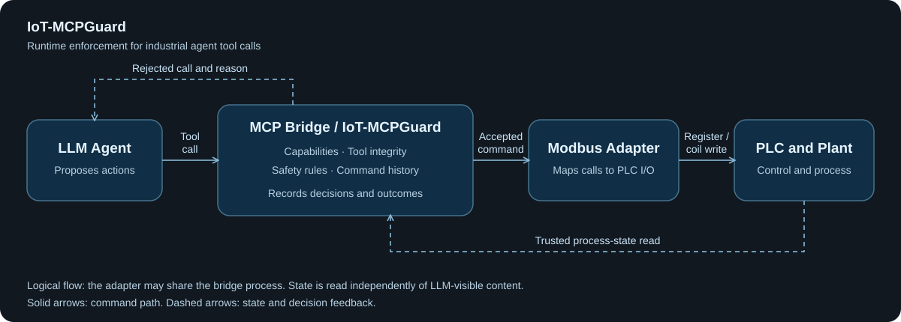

# IoT-MCPGuard

**Runtime security gateway for industrial AI agents.**

| Item | Description |
|---|---|
| Research started | 2026 |
| Repository | [waterwoods-sec/iot-mcpguard](https://github.com/waterwoods-sec/iot-mcpguard) (planned public location) |
| Package | Prototype documentation |
| Development stage | Research prototype; targeting Technology Readiness Level 4 (TRL 4) |
| Documentation updated | October 2026 |

## Overview

IoT-MCPGuard is a runtime defense framework for AI-assisted industrial Internet of Things (IIoT) operations. Large language model (LLM) agents can use the Model Context Protocol (MCP) to operate industrial equipment. Malicious instructions embedded in the content an agent reads may then induce unauthorized or unsafe control actions. The project aims to reduce these risks while preserving legitimate automation.

IoT-MCPGuard runs inside the MCP bridge between the agent and the industrial control system. It checks tool permissions, tool-definition integrity, process-state constraints, and command history. Accepted commands then pass through a Modbus adapter to a programmable logic controller (PLC). The guard obtains process measurements independently of the information presented to the LLM. A rejected call returns its reason to the agent so that the agent can replan.

## Defense components

| Component | Purpose |
|---|---|
| Capability checks | Check that the credential is valid and covers the tool, server, device, and permitted operation. |
| Tool integrity checks | Compare tool definitions with a trusted manifest or approved baseline. |
| Safety checks | Apply configured value limits, state-dependent interlocks, mode restrictions, and rate limits. |
| Command-history checks | Detect selected command patterns, including repeated changes and monotonic ramps. |

The current history checks are rules over commands, not a predictive digital twin. Configuration-snapshot authorization and version binding are under separate investigation; they are not part of the existing bridge.

## Documentation

- [Architecture](docs/architecture.md): components, data flow, and implementation boundaries.
- [Threat model](docs/threat-model.md): attacker capabilities, trusted components, and protection goals.
- [Validation](docs/validation.md): available evidence, limitations, and the TRL 4 validation target.

## Release status

This package contains documentation and editable diagram assets. It does not bundle executable source, datasets, experiment ledgers, or release-specific test logs. No open-source license has been selected for this package.

TRL 4 is a development target, not an independently assessed maturity rating. The evaluation must measure both defensive effectiveness and performance on legitimate workloads. Blocking a command does not, on its own, show that a physical hazard was prevented.
