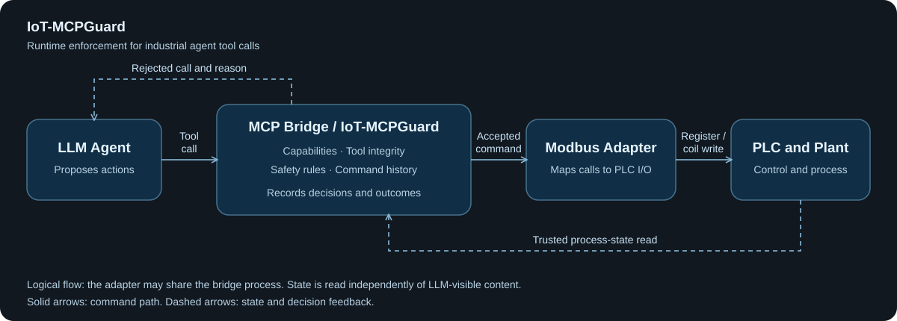

# Architecture

## Scope

IoT-MCPGuard mediates supervisory tool calls from an LLM agent to an industrial controller. The development implementation uses an MCP-facing JSON-RPC bridge, a Modbus TCP client, an OpenPLC controller, and a simulated process. The diagram shows logical roles; the guard and the Modbus adapter may run in the same bridge process.

The editable [Mermaid source](../assets/architecture.mmd) is also included.

## Request and feedback paths

1. The agent proposes a tool call with its arguments and authorization metadata.
2. The bridge checks the capability against the requested tool, server, device, and operation.
3. Tool integrity checks compare the tool definition with the trusted baseline or signed manifest.
4. The bridge reads process state directly from the PLC and evaluates the configured safety rules.
5. Command-history checks evaluate the call against the configured pattern rules.
6. If the checks permit the call, the Modbus adapter translates it into the corresponding register or coil operation.
7. The bridge records the decision and returns a result or rejection reason. A rejected call does not reach the actuator-write path.

The trusted-state path is independent of LLM-visible tool content. This independence does not imply a physically separate network or an atomic measurement of the entire plant. The design assumes the integrity of the PLC and its communication path (see the [threat model](threat-model.md)).

## Components and limits

| Component | Development behavior | Important boundary |
|---|---|---|
| Capability manager | Checks signed credentials, tool/server/device scope, permissions, expiration, and revocation; the server configuration also enables request nonce checks. | Safety rules enforce parameter-value bounds separately. Current tokens do not encode a complete task intent or the lifetime of physical effects. |
| Tool integrity verifier | Checks canonical tool metadata and, in the defended server configuration, an externally provisioned signed manifest. | A matching definition does not show that the tool implementation is benign. A baseline taken from an untrusted initial snapshot is itself untrusted. |
| Safety checker | Applies configured ranges, process-state conditions, control-mode restrictions, and rate limits. | Configured thresholds are evaluation policies, not certified equipment safety limits. |
| Trajectory monitor | Applies command-history heuristics, including rates, ramps, and selected sequences. | It does not model plant dynamics or predict whether a future trajectory is safe. Its mode-sequence rule looks back only three commands, so it can miss an earlier mode change. |
| Modbus adapter | Converts engineering values to the register representation and issues PLC reads and writes. | A successful write acknowledgement does not show that the physical outcome is safe. |
| PLC and process | Execute controller logic and evolve the process state. | PLC scan semantics, retained configuration, actuator response, and independent protective logic affect the outcome. |

The checks run in one enforcement service, so they are not four independently isolated security boundaries. Complete mediation requires deployment controls that prevent the agent from writing directly to the PLC.

## Experimental configuration authorization

A separate study examines stored configuration that becomes active after a mode change. The proposed checks bind approval to the configuration snapshot being activated and to its version. Temporary and persistent configuration need separate, explicit policies: expiry of a write credential does not, by itself, mean that an existing configuration must be reverted.

This extension remains a research candidate. In preliminary model-based comparisons on a fixed controller, a simple snapshot-and-version check produced the same outcomes as automatic dependency extraction (see [validation](validation.md)). The simpler mechanism is therefore the first candidate. The study does not show that physical hazards are prevented, and it does not support a claim of a new general authorization model.

## Current exclusions

- A predictive digital twin is not in the current enforcement path.
- Cross-server context isolation is not implemented in the evaluated single-bridge deployment.
- The bridge reads, checks, and writes in sequence, so authorization is not atomic at the PLC scan boundary.
- The gateway does not replace independent safety functions or a plant-specific recovery controller.
